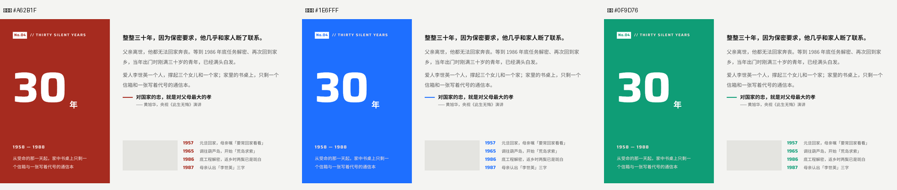

# endfield-deck

**用「终末地风味」的工业科技感做可照读的演示稿，主题色随便换。**

一个给 AI 助手用的 Skill 包：给它一句话（"做一份讲黄旭华的 PPT，用红色"），它会产出一整套合规的 PPTX —— 版式、配色、逐字讲稿、验收报告。

---

## 它解决的两个真问题

### 问题 1：换色全靠手调，改一个 hex 要重排一遍

大多数设计规范给的是「强调色 = 黄色，换色请自行修改」。结果就是：换到红色时，没人算过红底上的白字够不够清晰、红字压在浅底上能不能读、深色页里的红色装饰线是不是等于隐形。

本包把换色变成**一次计算**：

```bash
$ python scripts/accent_gen.py "#A62B1F" --name 深红

【色板】
  accent（强调色）      #A62B1F
  deep（满版底色）      #7E1D14   ← 满版页用它，文字走白色
  soft（浅底强调块）    #E18A81   ← 浅底上用它，文字走墨色
  tint（极淡纹理）      #F8E5E3   ← 背景质感，只此一处
  fore（accent 上的字） #FFFFFF   ← 自动决策

【四组对比度实测】
  墨字 #161616 压 accent      2.57:1    不可用 —— 墨色压不住这个色
  白字压 accent               7.03:1    可用
  accent 作字压纸底           6.38:1    可用
  accent 作线压墨底           2.50:1    不可用 —— 深色页里强调线要换白色
```

四条读数直接推出两条硬规则：**accent 上写白字**、**深色页的强调线不能用 accent**。

还有一个语义判断：红色在设计规范里通常被规定「只给删除」。本包把它改成**条件式** —— 项目里没有删除/危险/撤销操作时，这个前提不成立，红色可以释放为强调色（但要在交付说明里写明豁免）。

### 问题 2：AI 写 PPT，最容易翻车的不是审美，是排版事故

文字重叠、跨行压行、图注条最后一个字被切、满版铺色把强调色稀释 —— 这些在生成的 PPTX 里肉眼难发现，但投影出去就是事故。

本包沉淀了 **12 条真实踩坑**（每条都有现象、根因、解法、检测方法），并提供**四步验收门禁**：

```bash
python scripts/build_deck.py --slides slides/ --out deck.pptx --accent "#A62B1F"   # 构建 + 自检
bash scripts/lint_deck.sh deck.pptx slides/                                          # 门禁 1：lint 零诊断
python scripts/scan_overflow.py --pptx deck.pptx --shots deck_shots/ --accent "#A62B1F"  # 门禁 2+3：几何 + 像素
python scripts/count_words.py slides/                                               # 附带：口播时长
```

`scan_overflow.py` 用 `slidep inspect` 输出的坐标做**文字重叠检测**和**越界检测**，用截图做**强调色面积统计** —— 大部分排版事故可以机器抓出来。

---

## 安装

把整个 `endfield-deck/` 目录放进任一位置，然后在需要的项目里让助手加载它。

**用户级（全局可用）**

```bash
cp -r endfield-deck ~/.workbuddy/skills/
```

**项目级（只在这个项目里用）**

```bash
cp -r endfield-deck <你的项目>/.workbuddy/skills/
```

**环境准备**（渲染需要字体配置）

```bash
export PATH="$HOME/.workbuddy/binaries/node/versions/22.22.2-6:$PATH"
export FONTCONFIG_FILE="<skill 目录>/assets/fonts.conf"
export FONTCONFIG_PATH="<skill 目录>/assets/fontconfig"
```

依赖：
- **slidep** —— WorkBuddy 内置的演示引擎，随应用提供
- **Python 3.7+** —— 脚本零第三方依赖（`scan_overflow.py` 的像素部分需要 Pillow，缺失时自动跳过）
- **字体** —— Saira（拉丁宽体）随包分发

---

## 用法

### 给 AI 助手的提示词

> 用 endfield-deck 做一份 PPT，主题是「XXX」，共 8 页，强调色用深红 #A62B1F，要有逐页演讲稿。

### 手工流程

```bash
# 1. 定色板
python scripts/accent_gen.py "#A62B1F" --name 深红

# 2. 写 DSL —— 每页一个文件，放 slides/ 目录
cat > slides/01.slide <<'EOF'
<Slide notes={`各位好，今天我分享的是……`} style={{
    width: 1280, height: 720, background: '#F4F4F2', flexDirection: 'column',
    fontFamily: 'Noto Sans SC', padding: 60,
}}>
    <Box style={{ flexDirection: 'row', alignItems: 'center', gap: 16, height: 34 }}>
        <Box style={{ width: 62, height: 30, background: 'ACCENT', flexDirection: 'row',
            alignItems: 'center', justifyContent: 'center' }}>
            <Text style={{ fontFamily: 'Saira', fontSize: 16, fontWeight: 700,
                color: 'ACCENT_FORE', letterSpacing: 1 }}>No.01</Text>
        </Box>
        <Text style={{ fontFamily: 'Saira', fontSize: 16, fontWeight: 700,
            letterSpacing: 2.6, color: '#5C5C5C' }}>// SECTION TITLE</Text>
    </Box>
    ...
</Slide>
EOF

# 3. 构建（自动注入主题色、逐页写入、逐页截图、逐页文本校验）
python scripts/build_deck.py --slides slides/ --out deck.pptx --accent "#A62B1F" --name 深红

# 4. 门禁
bash scripts/lint_deck.sh deck.pptx slides/
python scripts/scan_overflow.py --pptx deck.pptx --shots deck_shots/ --accent "#A62B1F"
```

---

## 目录结构

```
endfield-deck/
├── SKILL.md                          入口：四步工作流 + 硬规则
├── README.md                         本文件
├── LICENSE                           MIT
├── references/
│   ├── theme-accent.md               换色六步、语义闸、四组对比度、派生算法、面积闸
│   ├── deck-layout.md                网格、字号档、颜色角色、九种页型、通用骨架
│   ├── slidep-dsl.md                 slidep 语法、组件、样式属性表、占位符
│   └── pitfalls.md                   12 条实战陷阱 + 四步验收门禁
├── scripts/
│   ├── accent_gen.py                 主题色引擎（text/json/css/slidep 四种输出）
│   ├── build_deck.py                 构建 + 主题色注入 + 静默失败检测
│   ├── scan_overflow.py              几何体检 + 像素体检
│   ├── lint_deck.sh                  逐页 lint 门禁
│   └── count_words.py                正文净字数 + 口播时长
└── assets/
    ├── tokens.deck.json              演示稿 token
    ├── fonts/                        Saira + OFL 许可证
    └── contours/                     等高线纹理（墨版 / 白版）
└── examples/
    └── theme-comparison.png          同一套 DSL 换三种主题色的实际效果
```

---

## 九种通用页型

封面 · 导语 · 要点列表 · 时间轴 · 数据看板 · 双栏对比 · 引言金句 · 高潮页 · 收尾

页型与**内容和主题色解耦**：换题材只改内容，换主题色只改一个 hex 值。

## 换色实际效果

同一套 DSL，构建时只改 `--accent` 一个参数：



左面板底色、巨型数字、时间轴年份、引文短线全部跟随主题色；右侧浅底区不受影响；accent 上的文字色由引擎按对比度自动决策。

---

## 设计语言

源自 [endfield-ui-skill](https://github.com/hhikr/endfield-ui-skill)（终末地风味），固定规则：

- 纸面加墨色，浅色为主，深色是另一套完整主题
- **一种强调色，只做填充** —— 当前位置、可点击内容、醒目提醒
- 切掉一个角 = 可以按；圆角一律为 0
- 宽体大写英文配粗体中文，`//` 眉标
- 编号、日期、计数都是真实数据
- 1px 细线分区，不用投影、发光、渐变

---

## 许可

本包代码与文档以 MIT 许可（见 `LICENSE`）。

视觉语言与设计规则源自 endfield-ui-skill，原 skill 声明其代码、模板、token 与规则可自由使用。

Saira 字体 © 2020 The Saira Project Authors，SIL Open Font License 1.1，许可证见 `assets/fonts/Saira-OFL.txt`。

等高线纹理由原 skill 的 `draw-contours.mjs` 生成。
